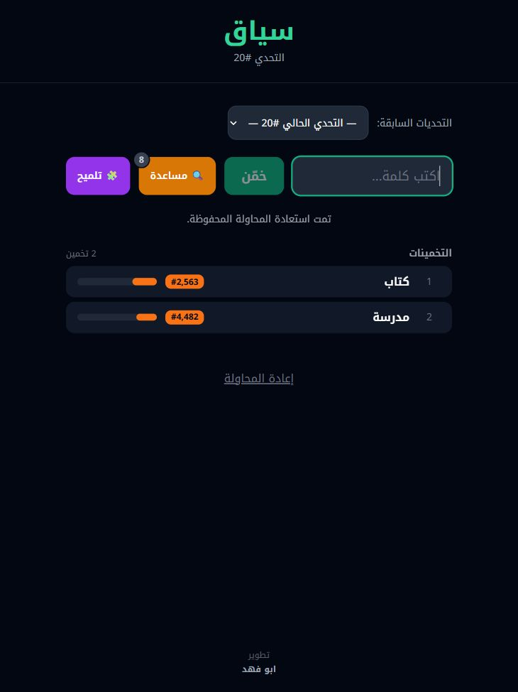

# سياق | Syaq

An Arabic daily semantic guessing game. Guess words and use their proximity ranks and hints to find the daily answer.

**[Play Syaq](https://syaq.online/) · [Mohammed AlDamegh](https://maldamegh.sa/)**

## Live game and offline example

[](https://syaq.online/)

The screenshot is a center crop of the public live game on 10 November 2026, after the example guesses `كتاب` and `مدرسة`. The live interface belongs to the complete service; the code in this repository covers only the selected modules described below. Game number, appearance, and available modes can change.

The published modules can also be explored offline:

```sh
python demo.py
```

```text
كتاب
{'games': [{'id': 1}], 'active_id': 1}
```

The input `  الْكِتَاب  ` becomes `كتاب`: diacritics, whitespace, and the definite-article prefix are removed for game equality. The synthetic metadata example retains the game ID and omits the example target word. Callers must still apply the release policy before serialization. [Captured plain-text output](examples/output.txt).

## What this repository contains

This is a curated source excerpt from Syaq, not a complete deployment of the live service. It contains the canonical Arabic normalization contract and its Python/JavaScript implementations, public game metadata serializers, and a URL logging helper. These small modules can be inspected and tested without cloud access, databases, trained models, or private data.

The normalization rules remove diacritics, normalize selected Arabic letters, and preserve the distinction between ي and ى. A shared specification generates matching Python and JavaScript code. The 29 conformance examples are synthetic.

## Run locally

Python 3.10 or newer, with no third-party dependencies:

```sh
python demo.py
python -m unittest discover -s tests -v
python scripts/normalization/generate_normalizers.py --check
```

With Node.js installed, also run:

```sh
node tests/check_normalizer.cjs
```

## Scope and provenance

Syaq is my personal project. I am publishing this selected source excerpt; the complete application and its data are not included.

The modules were copied from the project's local source; this packaging adds documentation, a small demo, and offline tests. The live game uses a broader system for preparing semantic rankings and serving them to players. This excerpt does not reproduce that pipeline or claim to reproduce its results.

Production infrastructure, credentials, logs, backups, user data, game answers, ranking tables, vocabulary datasets, model weights, and the original Git history are excluded. Some dataset-derived artifacts have unresolved redistribution requirements and are not part of this repository.

No open-source license is granted by this publication. Third-party packages and datasets retain their respective rights. See [PUBLICATION.md](PUBLICATION.md).

## Limits of this excerpt

- The metadata serializers omit answer fields but do not filter unreleased games themselves. Callers must apply the release policy before passing games to them.
- The URL logging helper removes user information, query parameters, and fragments. It preserves the URL path, so it is not a general-purpose secret scanner.
- The tests cover these isolated modules only. They do not establish ranking quality, production security, or readiness for a ranking-system release or launch.
